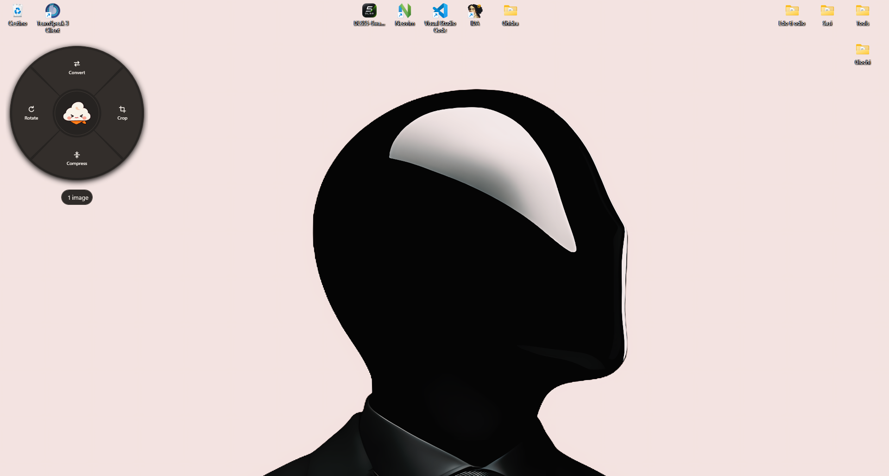
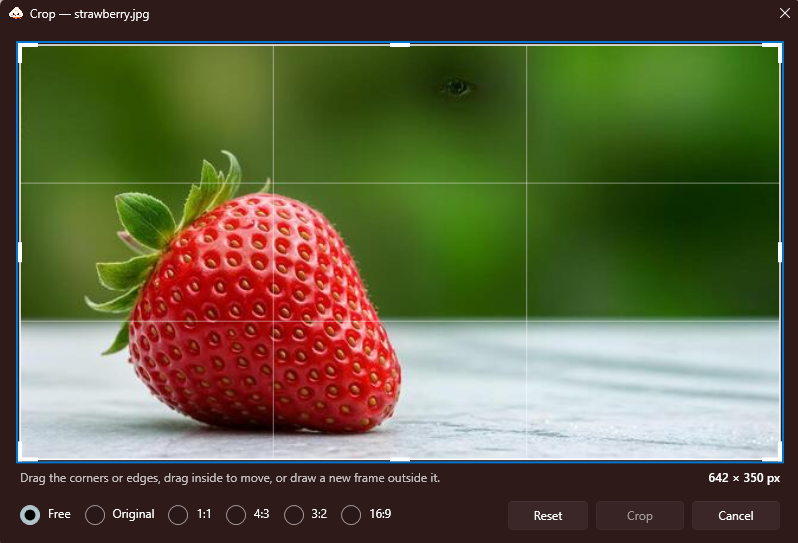

# Kumo

<p align="center">
  
</p>

Kumo puts common file actions in a radial menu on Windows. Start dragging files in File Explorer or on the desktop,
tap **Shift** while holding the mouse button, then move to an action and release.

## What it does

**Images:** convert PNG, JPEG, WebP, BMP and GIF (first frame) to PNG, JPEG, WebP, BMP or PDF; crop, rotate, and
compress JPEG/WebP. PNG compression is lossless. Transparency is placed on white when saving to JPEG or BMP.

**PDFs:** convert pages to PNG or JPEG, combine images into a PDF, merge PDFs, split a PDF into one file per page,
extract selected pages, or create a password-protected copy. PDF pages are rasterized at 150 DPI when converted to
images.

Video, audio, HEIC, TIFF, Word documents, PDF text extraction and image resizing are not supported yet.

## Files stay on your PC

Kumo processes files locally and never uploads them. It does not overwrite originals; results are written as new files
beside the source or to an output folder you choose. If automatic update checks are enabled, Kumo contacts GitHub to
look for a newer version; that check does not send file contents or paths.

## Use

- **Drag menu:** drag files from File Explorer or the desktop, tap Shift, choose an action, then release.
- **Keyboard:** press **Ctrl+Alt+K** to open the menu for the current selection. The shortcut can be changed in Settings.
- **Tray:** open Kumo from the notification-area icon and select files.

Kumo never overwrites an original. By default it keeps originals; Settings can move them to the Recycle Bin after a
successful operation. When an output name already exists, Kumo adds a number unless you choose to replace an older
result.

## Updates

Choose **Release**, **Beta** or **Development** in Settings. Beta includes beta and release-candidate builds;
Development also includes alpha and dev builds. A source build has no update feed configured.

## Screenshots

### Radial menu

<p align="center">
  
</p>

The menu opens over the current selection. Its actions depend on the selected files; this example shows the image
actions available for one image.

### Crop editor

<p align="center">
  
</p>

Drag the crop frame's edges or corners, or choose a preset ratio such as 1:1, 4:3 or 16:9. Kumo saves the crop as a
new image and leaves the original untouched.

## For developers

Kumo is a C#/.NET 10 Windows desktop app. The UI is WPF; image and PDF operations are kept separate from the shell
integration:

- `Kumo.Core` — file and operation models, settings, and shared logic.
- `Kumo.Operations` — image processing with SkiaSharp and PDF operations with PDFsharp and Windows' PDF renderer.
- `Kumo.Windows` — Explorer, tray, hotkey, input and other Windows integration.
- `Kumo.App` — WPF interface and application lifecycle.

Builds target Windows 10 version 2004 or later. Release installers support x64 and ARM64; the per-user installer
does not need administrator rights. Building requires Windows and the .NET 10 SDK (10.0.400 or later, selected by
`global.json`).

```powershell
dotnet build Kumo.slnx -c Release
dotnet test Kumo.slnx -c Release
dotnet run --project src/Kumo.App
```

CI runs formatting checks, version validation, build and tests on Windows. To prepare a release installer locally,
use `tools/package-release.ps1`; it requires NSIS 3 and builds self-contained installers for x64 and ARM64.

See [CONTRIBUTING.md](CONTRIBUTING.md) for setup and contribution guidance, and [SECURITY.md](SECURITY.md) for
private vulnerability reports.

## License

Kumo is licensed under the [MIT License](LICENSE). See [third-party notices](THIRD-PARTY-NOTICES.md) for the
licenses of components redistributed with the Windows installers.
